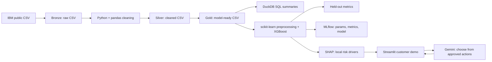
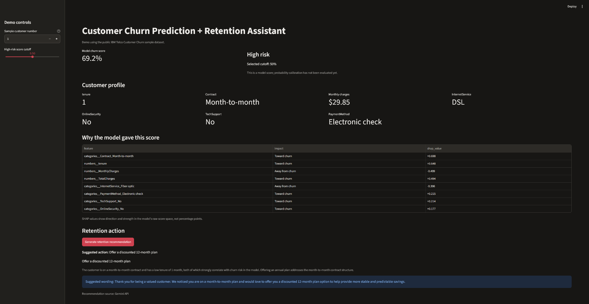
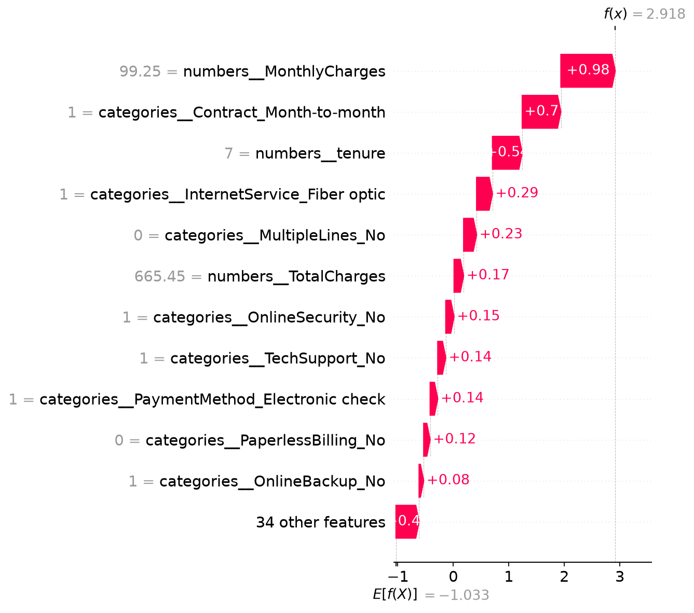

# Customer Churn Prediction + GenAI Retention Assistant

A portfolio project that prepares telecom churn data, predicts churn risk, explains individual predictions with SHAP, and suggests a retention action from an approved action list with Gemini.

> **Scope:** This is a learning/demo project using IBM's public Telco Customer Churn sample. It is not a production retention system, and its model scores are not calibrated probabilities or guaranteed outcomes.

## Architecture



## Demo

The app displays a customer profile, churn score, SHAP drivers, and a retention action chosen by Gemini from the approved list.



Example local SHAP waterfall for a held-out high-risk customer. Positive contributions move the model's raw score toward churn; they are not probability percentage points.



## What it does

1. Reads the raw IBM CSV into the Bronze layer without changing the source file.
2. Cleans whitespace and converts `TotalCharges` to numeric. The 11 blank `TotalCharges` values occur for customers with zero tenure and are set to 0.
3. Writes a Silver table and a Gold table. Gold removes `customerID` and maps `Churn` to `1` (churned) / `0` (stayed).
4. Uses DuckDB SQL to summarize churn rates by contract type.
5. Trains an XGBoost classifier inside a scikit-learn preprocessing pipeline. The model returns a churn score; the demo uses 0.50 as an initial cutoff.
6. Evaluates on a stratified held-out test split and logs the run, metrics, confusion matrix, and model to MLflow.
7. Uses SHAP to show which features moved a selected prediction toward or away from churn.
8. Sends the customer profile and SHAP reasons to Gemini only when the user clicks the recommendation button. Gemini must choose one of four approved actions; the app validates the returned action ID. Without an API key or if the request fails, it uses a clearly labeled local fallback.

## Results

One stratified 80/20 train/test split with `random_state=42`, evaluated at the initial 0.50 cutoff:

| Metric | Result |
| --- | ---: |
| ROC-AUC | 0.841 |
| F1 | 0.583 |
| Precision | 0.667 |
| Recall | 0.519 |
| Accuracy | 0.803 |

Confusion matrix (rows = actual `[stayed, churned]`; columns = predicted `[stayed, churned]`):

```text
[[938,  97],
 [180, 194]]
```

At this cutoff, the model identified 194 of 374 churners and missed 180. It flagged 97 customers who stayed. The 0.50 cutoff is a starting point, not a business-optimized threshold. Threshold tuning should use validation data, with the final test set kept untouched.

The model scores have not been checked for calibration. Treat them as ranking scores for this demo, not literal individual churn probabilities. SHAP values are in the model's raw-score/log-odds space, not probability percentage points. These are associations in historical sample data, not causal explanations.

## Tech stack

- Python 3.13
- pandas, scikit-learn, XGBoost, SHAP
- DuckDB SQL
- MLflow with a local SQLite tracking database
- Streamlit
- Gemini API (`google-genai` SDK)

## Setup on Windows

Open PowerShell in the project folder.

```powershell
py -3.13 -m venv .venv
.\.venv\Scripts\python.exe -m pip install --upgrade pip
.\.venv\Scripts\python.exe -m pip install -r requirements.txt
```

Download the public dataset into the raw/Bronze folder:

```powershell
New-Item -ItemType Directory -Force .\data\raw | Out-Null
Invoke-WebRequest `
  -Uri "https://raw.githubusercontent.com/IBM/telco-customer-churn-on-icp4d/master/data/Telco-Customer-Churn.csv" `
  -OutFile ".\data\raw\Telco-Customer-Churn.csv"
```

Prepare the tables, train and log the model, and produce a SHAP example:

```powershell
.\.venv\Scripts\python.exe .\src\prepare_data.py
.\.venv\Scripts\python.exe .\src\train_model.py
.\.venv\Scripts\python.exe .\src\explain_model.py
```

## Run the demo

Start Streamlit:

```powershell
.\.venv\Scripts\python.exe -m streamlit run app.py
```

In the app, choose a sample row and risk cutoff. Review the churn score and SHAP drivers, then click **Generate retention recommendation**. The app does not send the known historical `Churn` label to Gemini.

### Optional Gemini API key

Create a key in [Google AI Studio](https://aistudio.google.com/app/apikey). Create `.streamlit/secrets.toml` locally with:

```toml
GEMINI_API_KEY = "your-key"
```

The secrets file is excluded by `.gitignore`. Never commit it or share the key. This demo uses a public sample dataset; do not send private customer data to a free-tier API.

## View MLflow

From the project folder, start the local tracking UI:

```powershell
.\.venv\Scripts\mlflow.exe server --backend-store-uri sqlite:///mlflow.db --host 127.0.0.1 --port 5000
```

Open <http://127.0.0.1:5000>, select the `churn-retention-assistant` experiment, and inspect the `xgboost-baseline` run. Metrics and parameters are on the run overview; the confusion matrix is under **Artifacts**. MLflow 3 also lists the logged model separately from the file artifacts.

## Project structure

```text
app.py                         Streamlit demo
src/prepare_data.py            Bronze -> Silver -> Gold and DuckDB SQL
src/train_model.py             XGBoost training, evaluation, MLflow logging
src/explain_model.py           Local SHAP explanation and waterfall plot
src/retention_assistant.py     Gemini prompt, action validation, local fallback
data/raw/                      Original public CSV (Bronze)
data/silver/                   Cleaned table
data/gold/                     Model-ready table
models/                        Local fitted pipeline
reports/                       SHAP plot
```

## Limitations and next improvements

- The IBM sample is historical and public; it is not representative of a live telecom customer base.
- No intervention outcomes are available, so the project cannot claim that the suggested actions reduce churn.
- The 0.50 threshold is illustrative. Choose a threshold on validation data based on retention capacity and the relative cost of missed churners versus unnecessary outreach.
- Probability calibration and fairness checks have not been performed.
- The current pipeline runs locally. Databricks/Delta Lake deployment is a future extension; Bronze/Silver/Gold here are local CSV layers.
- The LLM selects and explains an action; an employee should review the suggestion before any customer contact.

## Data source

- [IBM Telco Customer Churn sample description](https://www.ibm.com/docs/en/cognos-analytics/12.0.x?topic=samples-telco-customer-churn)
- [IBM public dataset repository](https://github.com/IBM/telco-customer-churn-on-icp4d)
